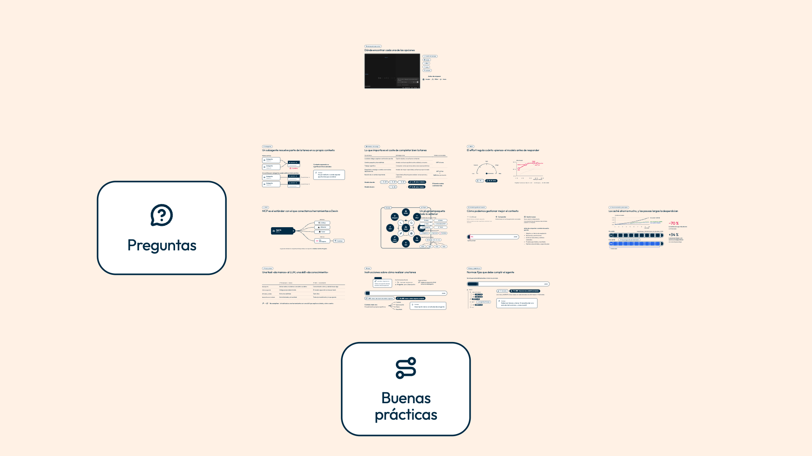
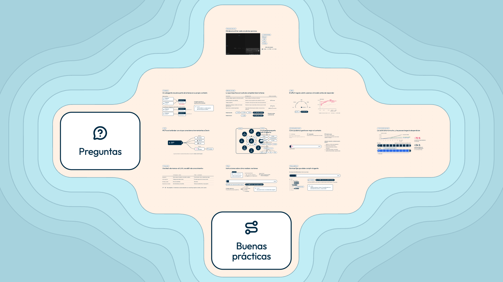

# Prototipo 3 · Claro llamativo con un fondo de mapa que no es plano

## Dirección

El mundo entero se convierte en una carta náutica. Los cinco bloques forman una isla de tierra crema, del color de fondo de las escenas, con su costa de esquinas redondeadas. Alrededor, un mar del cian de openbank.es, aclarado, que se oscurece por escalones iguales hacia fuera. Los escalones están separados por curvas de nivel.

Sobre la tierra hay una retícula de puntos muy tenue, el «papel» del mapa. El fondo tiene dos niveles:

- **De lejos** (vista general, ≈ 0,12): la isla y el mar, que enmarcan la cruz.
- **De cerca** (escala 1): solo tierra y retícula. Costa y curvas nunca pasan por debajo de una pantalla.

Parto de la paleta del prototipo 1 sin tocarla. Solo añado el fondo.

| Antes (prototipo 1) | Ahora |
|---|---|
|  |  |

## Qué cambia respecto al prototipo 1

Nada de lo que ya había: mismos roles, misma semántica, mismos trazos y pesos. Solo se añade:

- **`design/design-system.css`**:
  - un grupo nuevo, «Color · fondo del mapa», con 5 roles derivados por `color-mix()` (ningún hex nuevo);
  - 9 medidas en «Componentes · medidas».
- **`design/componentes.css`**: un componente nuevo, «Fondo del mapa» (`.fondo-mapa`), con su cabecera completa.
- **`design/dibujos.js`**: `fondoMapa({ bloques })`, la geometría. No lleva colores; devuelve un `<svg>` con las clases del componente.
- **Montaje mínimo en `src/`**:
  - `src/tapas.js` expone `rects`, lo que ocupa cada tapa (3 líneas);
  - `src/mundo.js` inserta el fondo como primer hijo de `#mundo` (1 línea y el import).
- **Documentación**:
  - `design/doc/laminas.js`: lámina «Vocabulario 8 · Fondo del mapa» (`capturas/extra/lamina-vocabulario-8.png`);
  - `design/doc/documentacion.js`: 14 pares de contraste nuevos, de todo lo que va sobre el fondo, medidos sobre la marca de la retícula.

Ni `motion.js`, ni la cámara, ni las escenas cambian.

## Cómo se construye

- **Campo de distancias.** `fondoMapa()` calcula la distancia a las tapas, tratadas como rectángulos con el radio de su esquina. Las une con un **mínimo suave** (`--mapa-suavizado`), que redondea también las esquinas entrantes entre bloques.
- **Curvas de nivel.** Salen de ese campo por *marching squares* en una rejilla de `--mapa-celda` y se simplifican con Douglas-Peucker. La costa está a `--mapa-costa` de las tapas; después vienen `--mapa-isobatas` curvas, cada `--mapa-isobata-paso`.
- **Sigue al mapa.** La isla sale de las tapas: si cambia `mapa.js`, la isla cambia con él.
- **Bandas del mar.** Cada banda es el mar de la costa con una opacidad de 1/n, 1/(n − 1)… 1 sobre la anterior. Así los escalones son iguales, del mar profundo al de la costa, con solo dos colores.
- **Retícula.** Es un `<pattern>` SVG, recortado a la tierra porque rellena el mismo trazado. La costa se dibuja encima, para que ninguna marca caiga sobre su línea.
- **Coste.** Se calcula una vez al montar: ≈ 11 ms (50 ms la primera vez, mientras el motor de JavaScript compila el código). En el DOM ocupa ≈ 26 KB de SVG. Va incrustado: la exportación sigue siendo un único HTML sin conexión.
- **Sin animación.** Se mueve con el mundo y nada más.

### Por qué en `#mundo` y no en `#escenario`

Es el mapa: tiene que escalar y desplazarse con la cámara.

- Así los vuelos se leen como un viaje: la costa se acerca y la retícula pasa por debajo.
- La isla queda anclada a los bloques.
- En `#escenario` sería un decorado fijo, quieto mientras el contenido vuela por encima, como una pantalla sucia.

Los dos niveles se resuelven con tamaños, sin JavaScript por fotograma:

- Lo de lejos (bandas, curvas de 24 px, costa de 16 px) se ve a 0,12 y nunca está bajo una pantalla.
- Lo de cerca (puntos de 4 px de radio cada 120 px) queda por debajo del píxel a menos de ≈ 0,2 y se funde con la tierra. Lo comprobé en recortes 1:1 a 0,12, 0,18 y 0,25: no hay muaré.

## Exploración y descartes (`capturas/descartes/`)

Hice tres ideas rápidas, inyectadas en la página, y luego afiné la elegida:

1. **Carta náutica con rectángulos redondeados** (`1-escalonado-general.png`). Era la idea buena con la geometría ingenua: la unión exacta de rectángulos deja las esquinas entrantes en ángulo recto, con aspecto de pagoda, y 6 curvas eran demasiadas líneas. Me quedé con la idea y cambié la geometría: mínimo suave, 4 curvas y bandas con escalones iguales.
   - Los puntos de 48 px con más contraste (`1-escalonado-puntos-48px-E06.png`) metían ruido detrás de las gráficas.
2. **Retícula cartográfica** (`2-reticula-general.png`): una cuadrícula de líneas y un degradado radial.
   - Es genérica, parece papel milimetrado.
   - Sus líneas cruzan las pantallas y compiten con las rejillas de gráficas y tablas.
   - De lejos no dice nada de la forma del mapa.
3. **Relieve de luz** (`3-luz-visitado.png`): una mancha clara bajo cada bloque, sobre una crema más profunda.
   - Es agradable, pero tenue y no se lee como mapa.
   - Un degradado tan grande puede verse a bandas en el proyector.

Dentro de la carta náutica también probé otras variantes. Estas dos capturas son de antes del ajuste de las bandas:

- **Mar de porcelana** (`4-mar-porcelana-general.png`): sobrio, pero apagado; no es «llamativo».
- **Mar azul royal** (`5-mar-azul-general.png`): grisáceo y frío.
- **Retícula de cruces** (`6-reticula-cruces-E24.png`): más cartográfica, pero junto al texto se lee como un «+». Me quedo con los puntos, más tranquilos.

## Variables nuevas (antes: no existían)

| Variable | Valor | Motivo |
|---|---|---|
| `--color-fondo-mapa-reticula` | Prussian 6 % sobre `--color-fondo` ≈ `#F0E5DB` | Marca de la retícula: el punto más oscuro bajo una escena. 6 % es el máximo con el que la pregunta 5 sigue en 3:1 |
| `--color-fondo-mapa-mar` | cian 30 % sobre blanco ≈ `#C1EDF5` | Mar junto a la costa: frío frente a la tierra crema, más llamativo que la porcelana y sin nada rojizo |
| `--color-fondo-mapa-mar-profundo` | Prussian 14 % sobre el mar ≈ `#A6D2DD` | Mar más allá de la última curva: da profundidad y enmarca la vista general |
| `--color-fondo-mapa-isobata` | Prussian 22 % sobre el mar ≈ `#97C2CF` | Curvas de nivel, visibles en la vista general |
| `--color-fondo-mapa-costa` | Prussian 35 % sobre el mar ≈ `#7EA9B8` | Borde de la tierra, más firme que las curvas |
| `--mapa-costa` | 240px | De las tapas a la costa. Ninguna pantalla queda a menos de 599 px de la costa |
| `--mapa-costa-trazo` | 16px | ≈ 2 px en la vista general y 7 px a media altura de un vuelo |
| `--mapa-isobatas` | 4 | Curvas alrededor de la isla. Con 6 había demasiadas líneas |
| `--mapa-isobata-paso` | 480px | ≈ 55 px entre curvas en la vista general |
| `--mapa-isobata-trazo` | 24px | ≈ 3 px en la vista general |
| `--mapa-suavizado` | 900px | Redondea las esquinas entrantes entre bloques |
| `--mapa-celda` | 60px | Rejilla de cálculo: precisión frente a tiempo de arranque |
| `--mapa-reticula-paso` | 120px | ≈ 16 × 9 marcas por pantalla; ≈ 14 px en la vista general |
| `--mapa-reticula-marca` | 4px | Radio de la marca; por debajo del píxel en la vista general |

## Contraste medido (WCAG)

Bajo una escena solo hay tierra (`--color-fondo`, igual que en el prototipo 1) y marcas de la retícula. Lo comprobé de dos formas:

- con `isPointInFill`, sobre los bordes de todas las pantallas más medio trazo de costa: ningún punto cae fuera de la tierra;
- la costa más cercana a una pantalla está a 599 px (E20).

Así que el punto más desfavorable es la marca, y todos los pares se miden sobre ella. Están también en la tabla de `design-system.html`.

| Par | Sobre el fondo | Sobre la marca | Mínimo |
|---|---|---|---|
| texto 1 · 2 · 3 | 13,2 · 10,5 · 6,8 | 11,8 · 9,4 · 6,1 | 4,5 |
| acento | 4,5 | 4,0 | 3 |
| contorno · serie 1 · pregunta 1 | 13,2 | 11,8 | 3 |
| corchete de caché · serie 2 · pregunta 3 | 4,6 | 4,1 | 3 |
| serie 3 · pregunta 2 | 4,0 | 3,6 | 3 |
| pregunta 4 · pregunta 5 | 3,5 · 3,5 | 3,14 · 3,09 | 3 |

Contrastes entre las piezas del fondo, que no llevan texto:

| Par | Contraste |
|---|---|
| marca / tierra | 1,12:1 |
| mar de la costa / tierra | 1,13:1 |
| mar profundo / tierra | 1,47:1 |
| blanco de las tapas / mar | 1,26:1 (sobre la tierra, 1,11:1) |
| contorno navy de las tapas / mar profundo | 9,0:1 |
| curva / banda de la costa | 1,48:1 |
| costa / tierra · mar | 2,3:1 · 2,0:1 |

## Comprobaciones y verificación

- **Comprobaciones del design system:** 22 de 22. La tabla de contraste tiene 87 pares, 14 más que en el prototipo 1, y todos llegan al mínimo.
- **Verificación de escenas** (`verificar`, de E02 a E31): resumen idéntico al del prototipo 1, línea a línea. No hay nada fuera de la zona segura, ningún texto baja de 24 px y los acentos son los mismos. Solo cambia el número de diferencias en E02/5 (3 → 2) y E31/1 (182 → 176), que dependen del instante en que se mide el anillo y la moneda, que giran. Las de E20/1, E24/1 y E30/1 son las de siempre.
- **Exportación:** `index.html`, servido en estático, pinta el fondo (4 curvas) y no hace ninguna petición externa.

## Fluidez de la cámara

Mido con GPU (`headless-gpu.mjs`) y el mundo sin `will-change`.

**Solo la cámara**, en la misma sesión, alternando con y sin fondo. Son 8 vuelos × 3 rondas con todo el mapa visitado (E31/1), el peor caso para pintar:

| | Sin fondo | Con fondo |
|---|---|---|
| Fotogramas | 1.904 | 1.906 |
| Intervalo medio | 16,67 ms | 16,67 ms |
| Fotogramas de más de 25 ms | 0 | 0 |
| Con la CPU ×4: más de 25 ms | 0 | 0 |

**Traza de Chrome**, 6 vuelos × 3 rondas:

| | Sin fondo | Con fondo |
|---|---|---|
| Paint (hilo principal) por fotograma | 0,51 ms | 0,53 ms |
| RasterTask por fotograma | 2,28 ms | 2,38 ms |
| Tarea de raster más larga | 7,8 ms | 6,7 ms |

En pintar, el fondo cuesta un 4–5 % más, muy lejos de los 16,7 ms de un fotograma. No usa filtros, ni `blur`, ni `feTurbulence`.

**Recorrido del brief** (E01/1 → general → E20/2 → O → O → E24/1 → E05 → E06 → Fin, 2 rondas):

| | Fotogramas de más de 25 ms (todos de ≈ 33 ms) |
|---|---|
| Base (prototipo 1) | 8 de 2.320 |
| Con fondo | 15 de 2.361 |
| Sin fondo, misma sesión y misma build | 13 de 1.938 |

Esos fotogramas salen a la vez que las escenas que se montan al llegar, con y sin fondo. Es ruido del recorrido, no del fondo: la medida limpia es la de la cámara sola.

## Lo que no me convence o queda pendiente

- **De cerca, el fondo es casi plano.** La retícula no puede pasar de 1,12:1: la pregunta 5 (3,09:1) y la 4 (3,14:1) están en el límite. En pantalla se ve, pero en un proyector probablemente desaparezca. Lo «no plano» se nota sobre todo en los vuelos y en la vista general. Si se quiere más textura a escala 1, hay dos caminos:
  - oscurecer las preguntas 4 y 5;
  - aceptar que esos dos colores solo van en números de 24 px o más y medirlos aparte.
- **La retícula no queda centrada igual en todas las pantallas.** Las pantallas están a 2080, 1240, 3280 y 4960 px, y no hay un paso razonable que divida todas esas distancias. Por eso el margen de las marcas va de 20 a 100 px según la pantalla. A 1,12:1 no se aprecia.
- **El mar es cian, como el razonamiento.** El rayado del razonamiento usa un cian claro (`#8EDEED` / `#CBF0F7`) de la misma familia que el mar. Nunca coinciden (el mar nunca está bajo una escena), pero en la vista general un token de razonamiento puede quedar cerca de la costa. Si molesta, el mar de porcelana (descarte 4) es la alternativa sobria.
- **Huecos bajo los logos de proveedor.** `.proveedor` pinta `--color-fondo` debajo para fundir el blanco de los logos, así que ahí tapa la retícula: falta alguna marca bajo los logos de E05 y E20. Es invisible a 1,12:1.
- **Pantalla que no es 16:9.** Si la ventana no es 16:9, las bandas negras del escenario quedan en crema plana y el mar se corta en el borde del escenario. En el proyector, a 16:9, no pasa.
- **La lámina «Mapa» de «Aplicado»** no muestra el fondo; la del vocabulario sí.

## Cómo aplicarlo al sistema real

1. **`design/design-system.css`**: el grupo «Color · fondo del mapa» (5 roles) y las 9 medidas `--mapa-*`, con sus comentarios. Están en el worktree.
2. **`design/componentes.css`**: el componente «Fondo del mapa», con su cabecera.
3. **`design/dibujos.js`**: `fondoMapa()` y sus ayudas (`distanciaRect`, `minimoSuave`, `simplificar`, `curvasDeNivel`).
4. **`src/tapas.js`** (`rects`) y **`src/mundo.js`** (insertar el fondo): dos cambios mínimos.
5. **`design/doc/laminas.js`** (lámina 8) y **`design/doc/documentacion.js`** (pares sobre la retícula).
6. **`CLAUDE.md`**: añadir «fondo del mapa» a la lista de `dibujos.js` y, en «La presentación», que el mapa es una isla sobre un mar. Después, revisar «Comprobaciones» y regenerar `DESIGN.md`.

Worktree: `/Users/ton/Desktop/Presentacion/.claude/worktrees/agent-a402d1726f63b9d1b`.

## Para el prototipo 4 (oscuro)

- **Se reutiliza tal cual:**
  - `fondoMapa()`, el componente y los cambios de `tapas.js` y `mundo.js`, que no dependen de la paleta;
  - la tierra, que es `--color-fondo`, así que sigue al fondo oscuro sin tocar nada.
- **Solo cambian los 5 colores `--color-fondo-mapa-*`.**
  - La tierra y el mar se tienen que distinguir por luminosidad, no solo por tono. Sobre navy, el mar puede ir un escalón más oscuro o más saturado que la tierra, siempre por `color-mix()` de la marca.
  - La lógica del punto más desfavorable se invierte: con texto claro, lo que resta contraste es una marca más clara que el fondo. Hay que medir la marca contra los roles claros más débiles (texto 3 y acento sobre oscuro); basta con apuntar los pares de `documentacion.js` a los roles inversos.
- **Escala:** a 0,12 las curvas necesitan unos 24 px de trazo para verse. La retícula desaparece sola si el radio de la marca se queda en unos 4 px.
